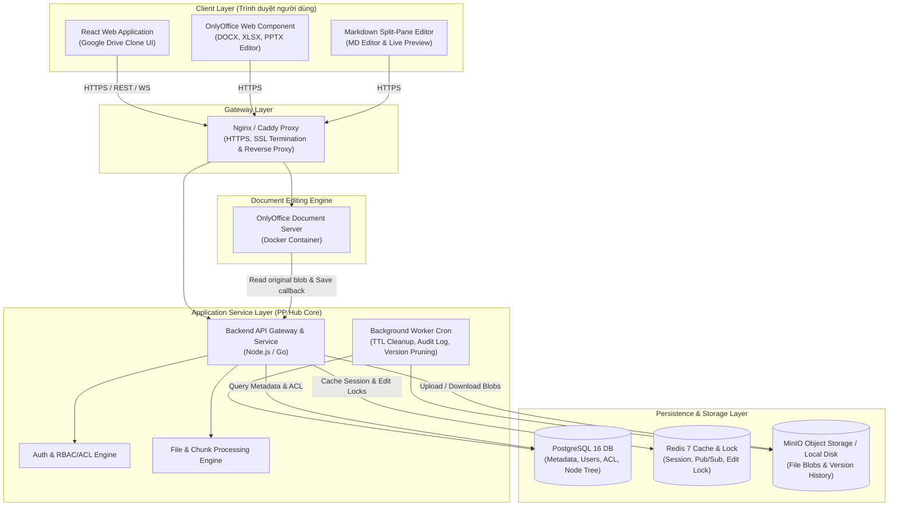
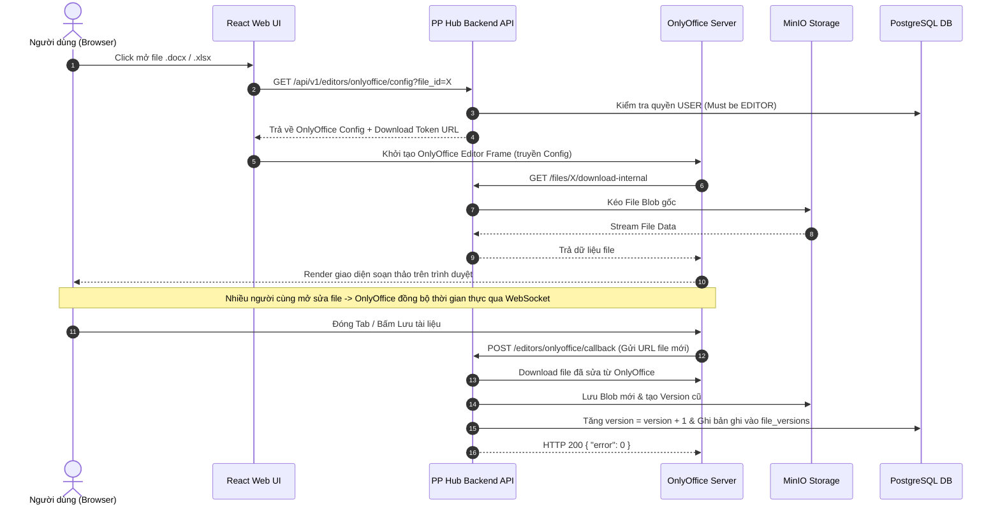
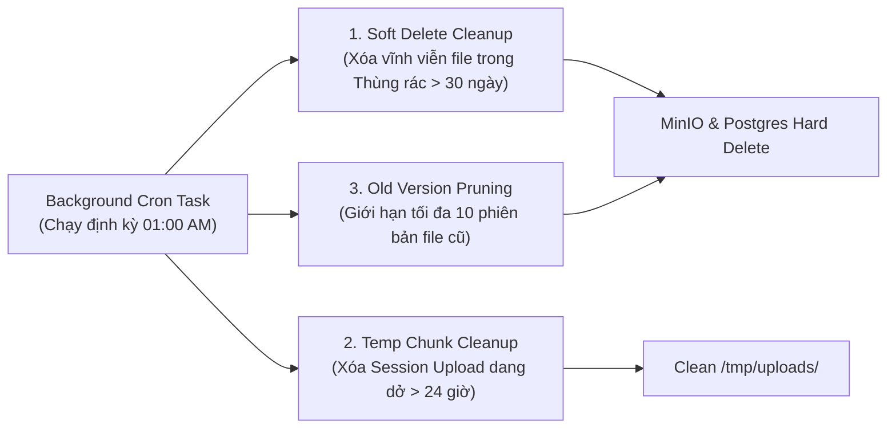

# Thiết Kế Kiến Trúc Hệ Thống: PP Hub

> **Loại hệ thống**: Enterprise Document Management & Collaboration Platform (Google Drive Clone cho Doanh nghiệp)  
> **Quy mô**: 20 – 50 nhân sự  
> **Mô hình triển khai**: Self-host (Cài đặt trên hạ tầng / Server / Cloud VPS riêng của doanh nghiệp)  
> **Mục tiêu**: Thay thế công cụ Google Drive để làm chủ dữ liệu nội bộ, tối ưu chi phí vận hành dài hạn, đảm bảo giao diện quen thuộc và hỗ trợ chỉnh sửa tài liệu Office/Markdown trực tiếp.

---

## 1. Yêu cầu hệ thống

### 1.1. Yêu Cầu Chức Năng (Functional Requirements)

- **Quản lý Không gian (Spaces) & Phân nhóm**:
  - **Space cá nhân (*My Drive*)**: Không gian lưu trữ riêng tư cho từng nhân viên.
  - **Space nhóm / phòng ban (*Team Spaces*)**: Không gian dùng chung cho từng bộ phận (Ví dụ: Phòng Kế Toán, Phòng Marketing, Phòng Dev, Dự Án X).
  - **Quản lý Nhóm (Groups)**: Phân nhóm nhân viên (Ví dụ: `@dev-team`, `@marketing-team`, `@managers`) để gán quyền nhanh cho tập hợp nhiều người dùng.

- **Quản lý File & Thư Mục (File System Management)**:
  - Hỗ trợ cấu hình phân cấp cây thư mục không giới hạn độ sâu.
  - Các thao tác chuẩn: Tạo thư mục, Tải lên (Upload), Tải xuống (Download), Đổi tên, Di chuyển (Move), Sao chép (Copy), Xóa.
  - **Quản lý Thùng rác (Trash / Soft Delete)**: File/Folder khi xóa sẽ đưa vào Thùng rác, cho phép khôi phục (Restore) hoặc xóa vĩnh viễn (Hard Delete).

- **Chỉnh sửa Tài liệu Trực tuyến (Online Editing & Collaboration)**:
  - **Tài liệu Office (`.docx`, `.xlsx`, `.pptx`)**: Chỉnh sửa trực tiếp trên trình duyệt web, hỗ trợ đồng sửa thời gian thực (Real-time Multi-user Collaboration) nhờ tích hợp **OnlyOffice Document Server**. Giữ nguyên 100% định dạng file.
  - **Tài liệu Markdown (`.md`)**: Trình soạn thảo Markdown tích hợp với chế độ xem trước (Live Preview split-pane) theo thời gian thực, lưu nhanh với `Ctrl + S`.
  - **Quản lý Phiên bản File (File Versioning)**: Tự động lưu vết và tạo phiên bản mới khi file được chỉnh sửa. Hỗ trợ xem lại lịch sử và khôi phục về các phiên bản cũ.

- **Phân Chuyển Quyền Hạn (ACL & RBAC Engine)**:
  - Phân quyền theo nhiều cấp độ chi tiết:
    - **Owner (Chủ sở hữu)**: Quyền tối cao đối với Space/File.
    - **Admin (Quản trị space)**: Quản lý thành viên và phân quyền trong Space.
    - **Editor (Chỉnh sửa)**: Xem, tải về, chỉnh sửa nội dung file.
    - **Viewer (Người xem)**: Chỉ được xem và tải về, không được sửa.
    - **Commenter (Bình luận)**: Xem và thêm ghi chú/bình luận.
  - **Kế thừa quyền tự động (Hierarchical Permission Inheritance)**: Thư mục con và file tự động kế thừa quyền từ Thư mục cha ngoại trừ trường hợp có thiết lập quyền riêng (Override).

- **Tìm kiếm & Phân loại**:
  - Tìm kiếm nhanh theo tên file, loại file (MIME type), người tạo, khoảng thời gian cập nhật.
  - Giao diện linh hoạt: Chế độ Lưới (Grid view) và Danh sách (List view).

---

### 1.2. Yêu Cầu Phi Chức Năng (Non-Functional Requirements)

- **Hiệu năng & Phản hồi (Performance)**:
  - Thời gian tải danh sách file/folder (Folder listing API): $< 200\text{ms}$ ($< 50\text{ms}$ khi sử dụng Redis cache).
  - Hỗ trợ tải lên file dung lượng lớn (tới 5GB+) bằng cơ chế **Chunked / Resumable Upload** (phân đoạn file).
  - Trải nghiệm đồng sửa Office mượt mà, độ trễ đồng bộ ký tự $< 100\text{ms}$.

- **Tính Tự Chủ & Bảo Mật Dữ Liệu (Data Sovereignty & Security)**:
  - **100% Self-hosted**: Toàn bộ dữ liệu nằm trên Server nội bộ hoặc Cloud VPS của công ty, không phụ thuộc bên thứ 3.
  - **Mã hóa kết nối**: HTTPS/TLS 1.3 bắt buộc cho mọi giao tiếp web và API.
  - **Xác thực & Phân quyền**: Hỗ trợ JWT Token, tương thích tích hợp LDAP / Active Directory / Google Workspace SSO.
  - **Nhật ký thao tác (Audit Log)**: Ghi lại toàn bộ hành vi xem, tải, sửa, xóa file của từng nhân viên để phòng chống rò rỉ dữ liệu.

- **Độ Tin Cậy & Sẵn Sàng (Reliability & Availability)**:
  - Cam kết Uptime 99.9% trong hạ tầng mạng nội bộ (LAN / VPN).
  - Không mất mát dữ liệu (Data Persistence) khi hệ thống bị khởi động lại hoặc restart các Docker container.

- **Khả năng Bảo Trì & Triển Khai (Maintainability & Deployment)**:
  - Triển khai và đóng gói hoàn chỉnh bằng **Docker Compose**, giúp đội ngũ IT thao tác cài đặt hoặc nâng cấp dễ dàng với 1 câu lệnh.

---

## 2. Ước Tính Dung Lượng & Tài Nguyên

Dưới đây là bảng ước tính nhu cầu tài nguyên cho quy mô doanh nghiệp **20 – 50 nhân sự**:

| Tiêu chí | Ưắc tính trung bình |
|---|---|
| **Số lượng nhân sự** | 20 – 50 người dùng |
| **Số người dùng đồng thời tối đa (Peak Active Users)** | 15 – 30 người sử dụng cùng một lúc |
| **Tải trọng request metadata (QPS)** | Peak 20 – 40 QPS (Thao tác duyệt folder, lấy danh sách file) |
| **Tải trọng Upload / Download** | Peak 2 – 5 requests / giây |
| **Dung lượng lưu trữ trung bình / nhân viên** | 30 GB – 50 GB / người |
| **Tổng dung lượng lưu trữ đĩa cứng ban đầu** | **1 TB – 2 TB SSD / NVMe** (Hỗ trợ mở rộng theo thời gian) |
| **Bộ nhớ RAM tiêu tốn cho OnlyOffice Engine** | ~50MB – 100MB RAM / 1 phiên chỉnh sửa Office (~2GB – 3GB RAM riêng cho container OnlyOffice khi 20 người đồng thời mở sửa file) |
| **Yêu cầu Băng thông mạng (Network Bandwidth)** | Mạng nội bộ LAN 1 Gbps hoặc đường truyền VPN $\ge 100\text{Mbps}$ |

### Đề Xuất Cấu Hình Phần Cứng Server / Cloud VPS (Self-hosted)

Để vận hành toàn bộ stack (Frontend, Backend, OnlyOffice, Postgres, Redis, MinIO), máy chủ cần cấu hình tối thiểu:
- **CPU**: 8 Cores (Intel Xeon / AMD EPYC / Modern x86_64)
- **RAM**: 16 GB DDR4/DDR5
- **Ổ cứng**: 2 TB SSD NVMe (Khuyến nghị RAID 1 mirroring hoặc có cơ chế Backup hàng ngày)
- **HĐH**: Ubuntu Server 22.04 LTS

---

## 3. Kiến Trúc Tổng Quan (Architecture Diagram)

Sơ đồ bên dưới thể hiện sự tương tác giữa trình duyệt người dùng, cổng Nginx Gateway, các microservices backend, OnlyOffice Document Server và lớp dữ liệu lưu trữ (PostgreSQL, Redis, MinIO):



---

## 4. Chi tiết các thành phần chính

### 4.1. Giao Diện Người Dùng (Frontend Web Application)
- Được xây dựng theo phong cách thiết kế quen thuộc của Google Drive:
  - **Thanh bên trái (Left Sidebar)**: Nút `+ Tạo mới` (Tạo folder, file Word/Excel/MD, Upload file), cây chuyển đổi giữa *My Space*, *Team Spaces*, *Được chia sẻ*, *Thùng rác*.
  - **Thanh tìm kiếm & Breadcrumb trên cùng**: Tìm kiếm thông minh và hiển thị đường dẫn thư mục hiện tại (`Root / Phòng Dev / Dự Án 2026`).
  - **Khu vực trung tâm (Main File View)**: Hỗ trợ Grid / List view, thao tác Drag & Drop upload file, Click chuột phải (Context menu) để thao tác nhanh.
  - **Panel thông tin bên phải (Inspection Panel)**: Xem chi tiết thumbnail, lịch sử phiên bản, kích thước file và danh sách người được phân quyền.

### 4.2. Backend API Gateway & Services
- Đảm nhận toàn bộ logic nghiệp vụ hệ thống:
  - Quản lý xác thực (JWT Auth), phân quyền truy cập (ACL & RBAC).
  - Quản lý cấu trúc cây thư mục (Adjacency List tree traversal).
  - Xử lý nhận file tải lên theo từng phân đoạn (Chunked Upload Engine).
  - Cung cấp RESTful endpoints và Webhook làm cầu nối với OnlyOffice Document Server.

### 4.3. Office Processing Engine (OnlyOffice Document Server)
- Đóng gói dưới dạng Docker container `onlyoffice/documentserver`.
- Chịu trách nhiệm render văn bản Office trực tiếp trên Web Browser.
- Quản lý phiên làm việc đồng thời (Multi-user session), tự động giải quyết xung đột khi nhiều người cùng nhập liệu qua kết nối WebSocket nội bộ giữa OnlyOffice Server và Client Browser.

### 4.4. Lớp Lưu Trữ Dữ Liệu (Storage Layer)

1. **Cơ sở dữ liệu PostgreSQL 16 (Metadata & ACL)**:
   - Lưu trữ toàn bộ thông tin tài khoản người dùng (`users`), nhóm (`groups`), không gian (`spaces`), cấu trúc cây file/folder (`nodes`), lịch sử phiên bản (`file_versions`), và phân quyền (`permissions`).

   *Sơ đồ bảng dữ liệu cốt lõi:*
   ```sql
   -- Bảng quản lý File & Thư mục (Tree Structure)
   CREATE TABLE nodes (
       id VARCHAR(36) PRIMARY KEY,
       space_id VARCHAR(36) NOT NULL,
       parent_id VARCHAR(36) REFERENCES nodes(id) ON DELETE CASCADE,
       name VARCHAR(255) NOT NULL,
       is_folder BOOLEAN NOT NULL DEFAULT FALSE,
       storage_key VARCHAR(512), -- Đường dẫn file lưu trong MinIO/Disk
       size_bytes BIGINT DEFAULT 0,
       mime_type VARCHAR(127),
       version INT DEFAULT 1,
       is_deleted BOOLEAN DEFAULT FALSE,
       deleted_at TIMESTAMP WITH TIME ZONE,
       created_by VARCHAR(36) NOT NULL,
       created_at TIMESTAMP WITH TIME ZONE DEFAULT NOW(),
       updated_at TIMESTAMP WITH TIME ZONE DEFAULT NOW()
   );

   CREATE INDEX idx_nodes_parent_space ON nodes(space_id, parent_id, is_deleted);

   -- Bảng Phân Quyền (ACL)
   CREATE TABLE permissions (
       id VARCHAR(36) PRIMARY KEY,
       node_id VARCHAR(36) REFERENCES nodes(id) ON DELETE CASCADE,
       space_id VARCHAR(36),
       target_type VARCHAR(10) NOT NULL, -- 'USER' hoặc 'GROUP'
       target_id VARCHAR(36) NOT NULL,
       role VARCHAR(20) NOT NULL, -- 'ADMIN', 'EDITOR', 'VIEWER'
       created_at TIMESTAMP WITH TIME ZONE DEFAULT NOW()
   );
   ```

2. **Bộ nhớ đệm Redis 7 (Caching & Distributed Lock)**:
   - Cache bảng phân quyền ACL để tăng tốc độ kiểm tra quyền ($< 5\text{ms}$).
   - Lưu trữ User Session Tokens và thực hiện Distributed Locking khi có thao tác chỉnh sửa file tránh xung đột race condition.

3. **MinIO Object Storage / File System (Blob Storage)**:
   - Lưu trữ nội dung thực tế của các file (File Blobs) theo cơ chế đường dẫn định danh hash: `/storage/{space_id}/{hash_key}`.
   - Lưu các file bản cũ trong lịch sử phiên bản (Version History).

---

## 5. Thiết kế API

Hệ thống thiết kế chuẩn RESTful API với định dạng trao đổi JSON:

### 5.1. API Quản Lý File & Thư Mục

#### `GET /api/v1/nodes` — Lấy danh sách File & Folder trong thư mục
- **Query Params**: `space_id`, `parent_id` (null nếu ở Root), `sort_by`, `search`
- **Response `200 OK`**:
  ```json
  {
    "current_folder": { "id": "f-123", "name": "Dự án 2026" },
    "items": [
      {
        "id": "node-001",
        "name": "Bao_cao_taichinh.xlsx",
        "is_folder": false,
        "mime_type": "application/vnd.openxmlformats-officedocument.spreadsheetml.sheet",
        "size_bytes": 1048576,
        "version": 2,
        "updated_at": "2026-10-03T10:00:00Z",
        "updated_by": "Nguyen Van A",
        "permission": "EDITOR"
      }
    ]
  }
  ```

#### `POST /api/v1/folders` — Tạo Thư Mục Mới
- **Request Body**:
  ```json
  {
    "name": "Tài liệu kĩ thuật",
    "space_id": "sp-dev",
    "parent_id": "f-123"
  }
  ```

#### `DELETE /api/v1/nodes/{id}` — Đưa File/Folder Vào Thùng Rác (Soft Delete)
- **Response `200 OK`**: `{ "message": "Moved to trash successfully" }`

---

### 5.2. API Resumable / Chunked Upload (Upload File Lớn)

#### `POST /api/v1/files/upload-session` — Khởi Tạo Session Upload
- **Request Body**:
  ```json
  {
    "name": "Ban_Thiet_Ke_3D.zip",
    "parent_id": "f-123",
    "space_id": "sp-dev",
    "total_size": 1073741824,
    "chunk_size": 5242880
  }
  ```
- **Response `201 Created`**:
  ```json
  {
    "upload_id": "upl-998877",
    "total_chunks": 205,
    "chunk_size": 5242880
  }
  ```

#### `PUT /api/v1/files/upload/{upload_id}/chunk/{chunk_index}` — Tải Lên Từng Chunk
- **Request Body**: Binary Data of Chunk
- **Response `200 OK`**: `{ "status": "chunk_received", "chunk_index": 0 }`

#### `POST /api/v1/files/upload/{upload_id}/complete` — Hoàn Tất Upload & Ghép File
- **Response `201 Created`**: `{ "node_id": "node-7766", "name": "Ban_Thiet_Ke_3D.zip" }`

---

### 5.3. API Tích Hợp Chỉnh Sửa (OnlyOffice & Markdown)

#### `GET /api/v1/editors/onlyoffice/config?file_id={id}` — Lấy Config Cho OnlyOffice Frame
- **Response `200 OK`**:
  ```json
  {
    "document": {
      "fileType": "docx",
      "key": "file-v2-hash-key",
      "title": "Ke_Hoach_Kinh_Doanh.docx",
      "url": "https://pphub.local/api/v1/files/node-001/download-internal"
    },
    "documentType": "word",
    "editorConfig": {
      "callbackUrl": "https://pphub.local/api/v1/editors/onlyoffice/callback?file_id=node-001",
      "user": { "id": "u-45", "name": "Tran Van B" },
      "mode": "edit"
    }
  }
  ```

#### `POST /api/v1/editors/onlyoffice/callback` — Webhook Nhận File Sau Khi Sửa
- Được OnlyOffice Document Server tự động gọi về khi người dùng bấm Lưu hoặc đóng tab chỉnh sửa để PP Hub cập nhật file blob và tăng số hiệu phiên bản (Version).

#### `GET /api/v1/files/{id}/content` & `PUT /api/v1/files/{id}/content` — Đọc & Ghi File Markdown (.md)

---

### 5.4. API Phân Quyền (Permissions)

#### `POST /api/v1/permissions` — Phân Quyền Truy Cập
- **Request Body**:
  ```json
  {
    "node_id": "f-123",
    "target_type": "GROUP", // 'USER' hoặc 'GROUP'
    "target_id": "grp-dev-team",
    "role": "EDITOR" // 'ADMIN', 'EDITOR', 'VIEWER'
  }
  ```

---

## 6. Luồng Xử Lý Dữ Liệu (Workflows)

### 6.1. Luồng Chỉnh Sửa File Office Trực Tuyến (OnlyOffice Flow)



---

### 6.2. Luồng Chỉnh Sửa File Markdown (.md)
1. **Mở file**: User chọn file `.md` $\rightarrow$ Web App gọi `GET /api/v1/files/{id}/content` để tải chuỗi plain-text.
2. **Soạn thảo**: Giao diện chia đôi màn hình (Split-pane): Bên trái gõ Markdown, bên phải render HTML live qua thư viện `marked` / `react-markdown`.
3. **Lưu file**: Người dùng bấm `Ctrl + S` $\rightarrow$ Web App gọi `PUT /api/v1/files/{id}/content` $\rightarrow$ Backend cập nhật file trên MinIO và cập nhật trường `updated_at` trong PostgreSQL.

---

### 6.3. Luồng Upload File Dung Lượng Lớn (Chunked Resumable Upload)
1. Client cắt file thành các đoạn nhỏ (mặc định 5MB/chunk).
2. Gọi API khởi tạo Session Upload $\rightarrow$ Nhận `upload_id`.
3. Gửi song song (Parallel 3 chunks) lên Server. Server lưu tạm các chunk vào thư mục đệm `/tmp/uploads/{upload_id}/`.
4. Khi upload xong chunk cuối cùng $\rightarrow$ Client gọi API `complete`.
5. Backend ghép nối các chunk thành 1 file duy nhất, tính toán mã Hash, lưu vào MinIO Blob Storage và ghi dữ liệu Metadata vào bảng `nodes`.

---

### 6.4. Luồng Kiểm Tra & Kế Thừa Quyền (Permission Evaluation Engine)
Khi người dùng $U$ thực hiện thao tác trên Node $N$ (File/Folder):
1. Hệ thống kiểm tra xem có bản ghi phân quyền trực tiếp cho $U$ hoặc Group của $U$ tại $N$ hay không.
2. Nếu có $\rightarrow$ Trả về Role trực tiếp đó.
3. Nếu không $\rightarrow$ Lần ngược theo `parent_id` lên thư mục cha.
4. Lặp lại cho đến khi tìm thấy bản ghi phân quyền hoặc chạm tới thư mục Gốc (Root Space).
5. Kết quả kiểm tra được lưu đệm vào **Redis Cache** với TTL 5 phút để tối ưu hiệu năng cho các thao tác duyệt file tiếp theo.

---

## 7. Cơ Chế Dọn Dẹp Dữ Liệu Hết Hạn (TTL Cleanup)

Để tránh lãng phí dung lượng đĩa cứng và tài nguyên hệ thống, PP Hub tích hợp các tiến trình dọn dẹp tự động chạy ngầm (Background Workers):



### 7.1. Dọn Dẹp Thùng Rác Hết Hạn (Soft Delete TTL 30 Ngày)
- File hoặc Folder bị xóa sẽ đánh dấu `is_deleted = true` và lưu thời điểm `deleted_at`.
- **Tiến trình Worker**: Chạy định kỳ vào **01h00 sáng hằng ngày**, quét các bản ghi trong bảng `nodes` thỏa mãn:
  $$\text{is\_deleted} = \text{true} \quad \text{AND} \quad \text{deleted\_at} < \text{NOW()} - 30 \text{ ngày}$$
- **Hành động**: Thực hiện xóa vĩnh viễn (Hard Delete):
  1. Xóa tất cả File Blobs tương ứng trên MinIO.
  2. Xóa các bản ghi lịch sử trong `file_versions` và `permissions`.
  3. Xóa bản ghi node khỏi bảng `nodes` trong PostgreSQL.

### 7.2. Dọn Dẹp Session Upload Dang Dở (Expired Upload Sessions TTL 24 Giờ)
- Trong trường hợp người dùng đang tải lên file lớn nhưng bị mất mạng hoặc đóng trình duyệt giữa chừng, các đoạn chunk tạm sẽ nằm lại tại thư mục đệm `/tmp/uploads/{upload_id}/`.
- **Tiến trình Worker**: Chạy định kỳ **mỗi 6 tiếng một lần**, tìm các Session Upload chưa hoàn thành được tạo cách đây hơn 24 giờ.
- **Hành động**: Xóa toàn bộ tệp tin chunk tạm trong đĩa cứng để thu hồi dung lượng.

### 7.3. Dọn Dẹp Phiên Bản File Cũ (File Version Pruning Policy)
- Để tránh việc tích tụ quá nhiều phiên bản file Office gây tốn dung lượng lưu trữ:
- **Chính sách**: Giới hạn lưu tối đa **10 phiên bản cũ nhất** cho mỗi tệp tin hoặc xóa các bản ghi phiên bản đã tạo quá **90 ngày**.
- **Hành động**: Khi một phiên bản mới được tạo khiến tổng số phiên bản $> 10$, hệ thống tự động phát lệnh xóa File Blob của phiên bản cũ nhất trên MinIO.

---

## 8. Mở Rộng, Bộ Nhớ Đệm & Bảo Mật

Dưới đây là bảng chi tiết các vấn đề hệ thống và giải pháp thiết kế tương ứng cho PP Hub:

| Vấn đề | Giải pháp thiết kế |
|---|---|
| **Bộ nhớ đệm (Caching System)** | Sử dụng **Redis 7** làm lớp Caching trung gian cho:<br/>1. Cache danh sách cây file/folder (`nodes`) theo `parent_id`.<br/>2. Cache kết quả phân quyền ACL của người dùng (TTL 5 phút).<br/>3. Lưu User Sessions Token.<br/>$\rightarrow$ Giúp giảm tới 80% truy vấn tới PostgreSQL, giữ phản hồi API danh sách file $< 20\text{ms}$. |
| **Khả năng mở rộng (Scalability)** | Tất cả các thành phần dịch vụ Core API và Frontend được đóng gói dưới dạng **Stateless Containers**.<br/>Khi quy mô nhân sự tăng từ 50 lên 200+ người dùng, có thể dễ dàng tách riêng máy chủ OnlyOffice Server và máy chủ MinIO Storage sang các VPS/Node riêng biệt mà không ảnh hưởng tới logic ứng dụng. |
| **Bảo mật & Tự chủ dữ liệu (Security & Data Control)** | 1. **Triển khai Self-hosted 100%**: Dữ liệu lưu tại máy chủ doanh nghiệp.<br/>2. **Mã hóa truyền tải**: Toàn bộ kết nối sử dụng HTTPS/TLS 1.3.<br/>3. **Xác thực**: JWT Token ngắn hạn (AccessToken 15 phút, RefreshToken 7 ngày), hỗ trợ tích hợp LDAP/Active Directory/SSO công ty.<br/>4. **Giới hạn số lần thử (Rate Limiting)**: Nginx Rate Limit ngăn chặn brute-force và DDoS nội bộ. |
| **Sao lưu & Phục hồi dữ liệu (Backup & Recovery)** | 1. **Metadata Backup**: Chạy Cronjob tự động thực hiện `pg_dump` cơ sở dữ liệu PostgreSQL lúc 12h đêm hàng ngày, đẩy file backup `.sql` sang máy lưu trữ NAS đệm.<br/>2. **File Storage Backup**: Sử dụng công cụ `mc mirror` của MinIO để đồng bộ các File Blobs mới sang ổ cứng NAS nội bộ hoặc máy chủ Backup vật lý riêng biệt. |
| **Quản lý Dung lượng (Quota Management)** | Cấu hình giới hạn dung lượng lưu trữ tối đa (Storage Quota) cho từng Không gian cá nhân hoặc Không gian phòng ban (Ví dụ: Nhân viên: 30GB, Trưởng phòng: 100GB, Space Dự án: 500GB) nhằm chủ động kiểm soát dung lượng đĩa cứng. |
| **Nhật ký thao tác (Audit Trail)** | Lưu lại toàn bộ lịch sử thao tác hệ thống vào bảng `audit_logs` (Bao gồm: `user_id`, `action`, `node_id`, `ip_address`, `timestamp`) đối với mọi hành vi xem, tải về, chỉnh sửa, phân quyền và xóa file để phục vụ việc kiểm toán bảo mật dữ liệu. |

---

## 9. Đánh Giá & Kết Luận

| Tiêu chí | Google Drive Cloud | PP Hub (Self-hosted) |
|---|---|---|
| **Chủ quyền dữ liệu** | Phụ thuộc bên thứ 3 (Google) | **100% Lưu tại máy chủ nội bộ doanh nghiệp** |
| **Chi phí dài hạn** | Tăng dần theo đầu người hàng tháng | **Chi phí cố định (Tiền phần cứng / Cloud VPS)** |
| **Trải nghiệm sử dụng** | Rất mượt | **Giống Google Drive 90% (Dễ dàng sử dụng ngay)** |
| **Chỉnh sửa Office** | Sử dụng Google Docs / Sheets | **OnlyOffice (Giữ nguyên 100% định dạng docx/xlsx)** |
| **Triển khai & Bảo trì** | Google tự quản lý | **IT công ty vận hành đơn giản qua Docker Compose** |

> **Tóm lại**: **PP Hub** là giải pháp thực tế, tối ưu chi phí và hiệu quả cao cho doanh nghiệp quy mô từ **20 – 50 nhân sự**. Không phức tạp rườm rà như các hệ thống Cloud hàng triệu người dùng, PP Hub tập trung giải quyết 3 giá trị cốt lõi: **Giao diện quen thuộc dễ dùng, Tự chủ bảo mật dữ liệu 100%, và Triển khai vô cùng dễ dàng.**
